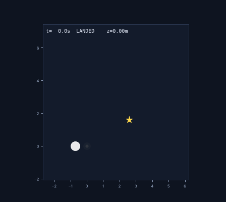
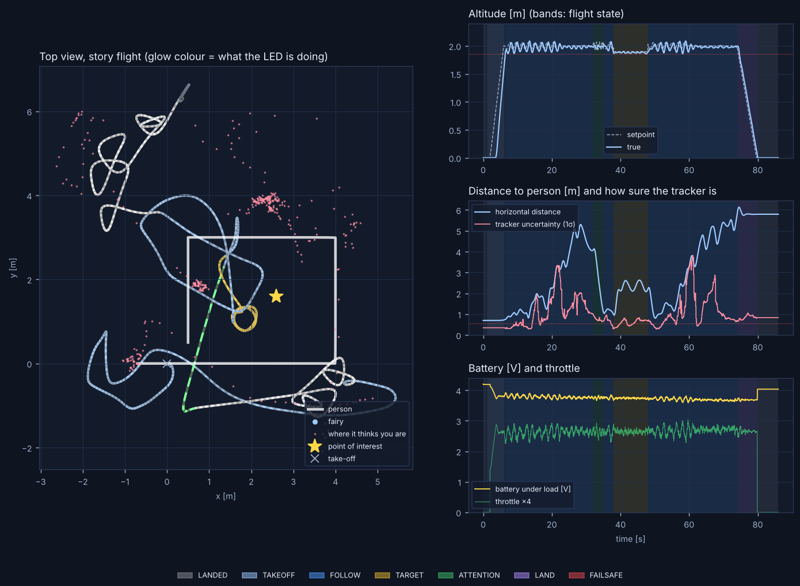

# Fairy companion drone

A design, a simulation and firmware for a palm-sized glowing drone that
behaves like a video-game fairy companion (inspired by Navi): it hovers near
you, flits around, darts off to look at things, bounces and chirps for
attention, and lands itself when its battery runs down.



**Status: designed and simulated, not yet built.** Nothing here has flown.
The flight logic passes 28 automated simulated-flight and protocol tests; the
ESP32 firmware has not been compiled for its target or run on hardware, and
the UWB radio driver for follow-me is not written. Details in
[docs/BUILD.md](docs/BUILD.md#what-has-and-has-not-been-tested).

## The short version

- **Hardware:** a 75 mm ducted 1S brushless whoop (Betaflight) carrying a
  Seeed XIAO ESP32-S3, a downward optical-flow + laser-range module, two RGB
  LEDs under half a ping-pong ball, a piezo, and film wings. About 56 g,
  about 4½ minutes per battery, about $260 including a radio. You wear a UWB
  beacon. Full parts list: [docs/DESIGN.md](docs/DESIGN.md#bill-of-materials).
- **Split of work:** Betaflight keeps the drone upright. The ESP32 moves the
  sticks 50 times a second, as a pilot would. A human with a radio keeps the
  kill switch.
- **One brain, two bodies:** the autopilot in `firmware/core` is plain C with
  no hardware in it. The simulator and the ESP32 firmware call the same
  function.

## What simulation says to expect

Across 40 flights on deliberately mis-built airframes, all 40 took off,
followed, and landed under control.

| | |
|---|---|
| You stand still | Stays 0.7–1.3 m away, knows where you are to ~15–20 cm |
| You walk | Trails 1–2 m behind, can drop 6–8 m back, then homes in |
| You stop | Usually back beside you within ~15 s |
| Battery low / sensor lost / beacon gone | Lands itself |

The honest limit: the drone only measures its *distance* to you, not your
direction, and that is not enough to fly at shoulder height beside a walking
person safely. So in follow mode it flies at 2 m, above your head. Why, and
what sensor would fix it, is in
[docs/DESIGN.md](docs/DESIGN.md#what-the-simulation-taught-us).



This is seed 1, shown as it came out, and it is a below-average flight: the
fairy tracks well through the first walk, the nag and the point of interest,
then loses the person on the walk back (white = homing on distance alone) and
lands about 6 m from them. The median flight ends about a metre away.

## Run the simulation

Needs Python 3.10+, gcc, numpy, matplotlib, pytest, pillow.

```
pip install numpy matplotlib pytest pillow
python3 sim/run.py                # the story flight: metrics + sim/out/story.png
python3 sim/run.py story --gif    # with animation
python3 sim/run.py --all          # every scenario
python3 sim/run.py --mc 40        # Monte Carlo over build tolerances (~6 min)
python3 -m pytest tests           # 28 tests, ~2 min
```

Scenarios: `story`, `standing`, `low_battery`, `flow_loss`, `beacon_dropout`,
`beacon_lost`, `table`, `endurance`.

## Build one

[docs/BUILD.md](docs/BUILD.md) is a three-stage guide: hover, then fairy,
then follow-me, with a bench checklist that catches wiring and sign mistakes
before the props go on.

```
cd firmware/esp32 && pio run -t upload
```

## Layout

```
firmware/core/    the flight brain: estimator, controller, behaviours, MSP codec
firmware/esp32/   PlatformIO project for the XIAO ESP32-S3 (thin hardware glue)
sim/              physics, sensor models, scenarios, plots; runs firmware/core
tests/            simulated-flight and protocol tests
docs/             DESIGN.md (why), BUILD.md (how)
```
